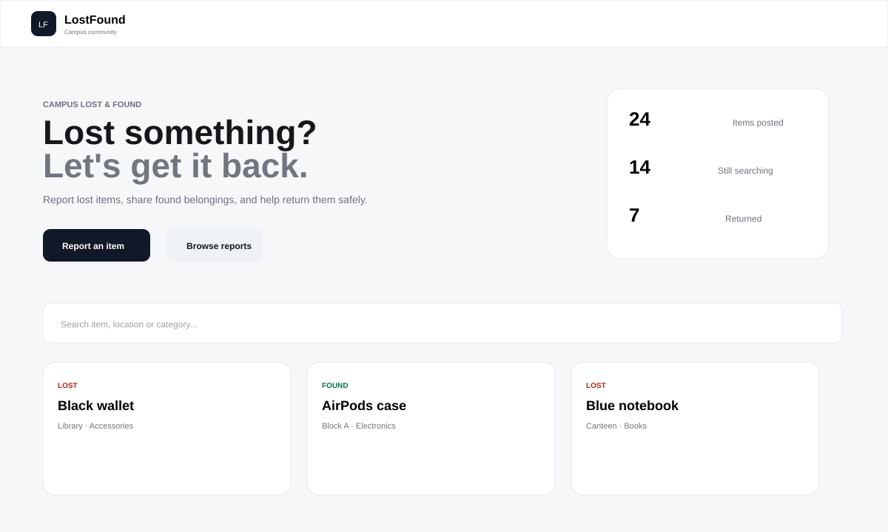
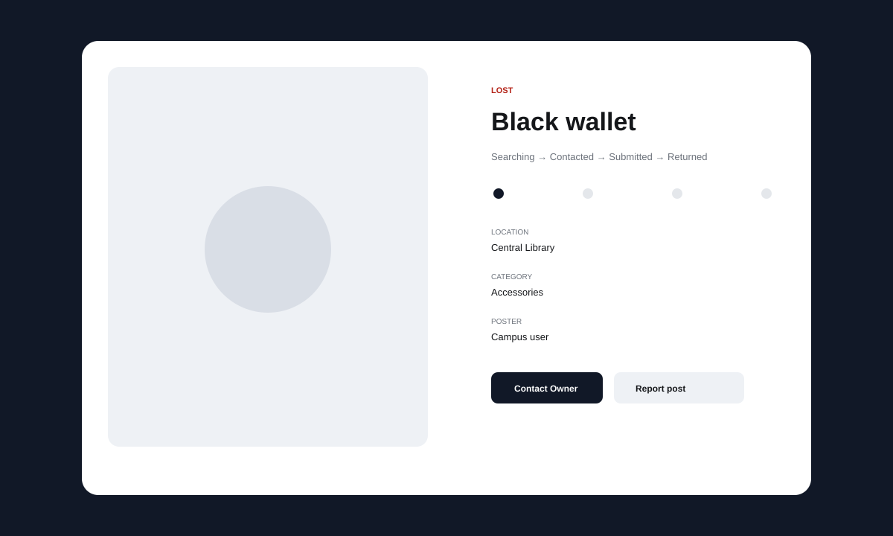

# LostFound

> A focused campus lost-and-found experience for reporting, discovering and safely returning items.

## Live Demo

### [Open LostFound →](https://lost-find-found.netlify.app/)

## Screenshots

These are lightweight UI previews included with the repository. For browser-captured screenshots, replace them with exports from the live demo.

| Campus board | Item details |
|---|---|
|  |  |

## Features

### Authentication
- Campus-branded Campus ID login
- 10-digit validation with inline feedback
- Explicit demo-mode disclosure

### Discovery
- Search by item, location and category
- Lost / Found filters
- Category and status filters
- Newest, oldest and urgent sorting
- Responsive report cards

### Item workflow
- Image upload and preview
- Urgent reports
- Dedicated item-details modal
- Searching → Contacted → Submitted → Returned
- Owner-only status changes
- Confirmation before marking an item returned
- Demo Contact Owner action

### Community & safety
- Comments
- My Posts management
- Delete your own posts
- Report inappropriate post
- Campus IDs hidden from public cards
- Safety guidance against sensitive information

### UI
- Responsive layout
- Light / dark theme
- Toast feedback
- Image details
- Empty states

## Project Flow

Campus ID → Community Board → Search / Filter → View Details → Contact Owner / Comment / Report → Searching → Contacted → Submitted → Returned

## Tech Stack

| Layer | Technology |
|---|---|
| Structure | HTML5 |
| Styling | CSS3 |
| Logic | Vanilla JavaScript ES modules |
| Storage | Browser localStorage |
| Images | FileReader / browser data URLs |
| Deployment | Netlify |

No framework or external UI library is required.

## Project Structure

LostFound/
├── index.html
├── login.html
├── post.html
├── myposts.html
├── css/
│   └── style.css
├── js/
│   ├── app.js
│   ├── auth.js
│   ├── posts.js
│   └── ui.js
├── assets/
│   ├── klh.png
│   ├── preview-board.svg
│   └── preview-details.svg
└── README.md

## Limitations

This version is intentionally frontend-first:
- Login is a browser-only demo identity.
- Reports are stored in localStorage and are browser/device specific.
- Contact Owner is a demo action; there is no private messaging backend.
- Images are stored as browser data URLs.
- Moderation is represented locally.

## Future Backend Plan

A production version can replace the local demo layer with:

Frontend → Secure Campus Authentication → REST API → PostgreSQL → Object Storage → Notifications / Private Messaging

The backend would provide verified campus accounts, persistent cross-device data, private owner contact, moderation, cloud image storage, notifications and audit history.

## Portfolio Direction

The repo stays intentionally focused instead of adding features for feature count. The goal is a believable campus product with a clear user journey, maintainable structure and a realistic path from frontend prototype to full-stack application.

## License

For educational and portfolio use.
